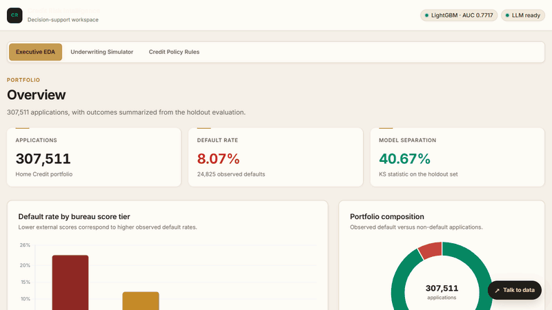
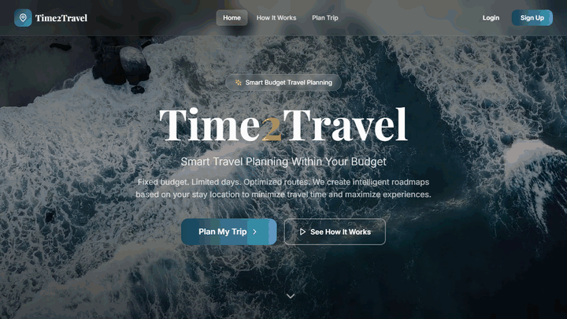

<p align="center">
  
</p>

<p align="center">
  <a href="https://www.linkedin.com/in/saurabhburnwal"></a>
  <a href="mailto:saurabhburnwal00@gmail.com"></a>
  <a href="https://github.com/saurabhburnwal?tab=followers"></a>
  
</p>

## 👨‍💻 About me

I'm an MCA (AI) student at CHRIST (Deemed to be University), Bengaluru, who builds machine-learning systems and the full-stack apps that put them in front of people.

```python
class SaurabhBurnwal:
    role       = "AI/ML & Full-Stack Developer"
    education  = "MCA (Artificial Intelligence) @ CHRIST University, Bengaluru"
    location   = "Bengaluru, India"
    focus      = ["Machine Learning", "NLP", "Computer Vision", "Full-Stack Web"]
    stack      = ["Python", "React", "Node.js", "FastAPI", "PostgreSQL", "LightGBM"]
    fun_fact   = "Responsibly disclosed a real vulnerability via HackerOne 🔐"
```

## 🛠️ Tech stack

<table align="center">
  <tr>
    <td align="center"><b>Languages</b></td>
    <td></td>
  </tr>
  <tr>
    <td align="center"><b>Web &amp; Backend</b></td>
    <td></td>
  </tr>
  <tr>
    <td align="center"><b>Data &amp; Cloud</b></td>
    <td></td>
  </tr>
  <tr>
    <td align="center"><b>AI / ML</b></td>
    <td>
      <br>
      
      
      
      
      
      
      
      
      
    </td>
  </tr>
  <tr>
    <td align="center"><b>Mobile</b></td>
    <td></td>
  </tr>
</table>

## 🚀 Featured projects

### 📊 Credit Risk Intelligence Platform

<a href="https://credit-risk-intelligence-platform-2k4b.onrender.com"></a>

A decision-support workspace for credit underwriting, built on a cost-sensitive **LightGBM** model trained on **307K+ loans**.

- **0.7717 ROC-AUC** and **0.2667 PR-AUC** on a 61.5K holdout set, with **SHAP** for model interpretation
- Underwriting simulator, credit-policy risk bands and a Groq-powered natural-language-to-SQL **"talk to data"** assistant
- Deployed on Render

<a href="https://credit-risk-intelligence-platform-2k4b.onrender.com"></a>
<a href="https://github.com/saurabhburnwal/credit-risk-intelligence-platform"></a>

### 🧭 Time2Travel

<a href="https://time2-travel.vercel.app/"></a>

Smart travel planning within a fixed budget: optimized, day-wise roadmaps across South India.

- Express backend with **15 controllers** and **84 REST endpoints** for authentication, roadmaps, expenses and roles
- Secure auth with bcrypt, JWT cookies, OTP verification and **RBAC** across Admin, Host and Traveler roles
- Three-service monorepo: React on Vercel, Express on Render, PostgreSQL on Supabase

<a href="https://time2-travel.vercel.app/"></a>
<a href="https://github.com/saurabhburnwal/Time2Travel"></a>

### 🧩 More projects

<table>
  <tr>
    <td width="50%" valign="top">
      <h4><a href="https://www.littora.app/">Littora</a></h4>
      <p>Integrates <b>3 YOLO model variants</b> through FastAPI and Node.js, on a PostgreSQL schema normalized to <b>5NF</b> with row-level-security RBAC.</p>
      <p><code>React</code> <code>Node.js</code> <code>FastAPI</code> <code>PostgreSQL</code> <code>Supabase</code></p>
      <a href="https://www.littora.app/">Live</a> · <a href="https://github.com/saurabhburnwal/Littora">Code</a>
    </td>
    <td width="50%" valign="top">
      <h4><a href="https://github.com/saurabhburnwal/crisis-nlp-triage">Crisis NLP: Disaster Tweet Triage</a></h4>
      <p>Sorts <b>76K+ crisis tweets</b> into High, Medium and Low priority with a 5-fold stacking ensemble, at <b>86.73% precision</b>.</p>
      <p><code>Python</code> <code>scikit-learn</code> <code>XGBoost</code> <code>SHAP</code></p>
      <a href="https://github.com/saurabhburnwal/crisis-nlp-triage">Code</a>
    </td>
  </tr>
  <tr>
    <td width="50%" valign="top">
      <h4>Academic ETL Pipeline</h4>
      <p>A <b>7-task Apache Airflow</b> pipeline with raw, staging and reporting layers, data-quality checks and 3 KPI tables.</p>
      <p><code>Airflow</code> <code>Python</code> <code>MySQL</code> <code>Docker</code></p>
    </td>
    <td width="50%" valign="top">
      <h4><a href="https://github.com/saurabhburnwal/go-farm-frontend">GoFarm</a></h4>
      <p>Fixed bugs in the React frontend for crop-cost prediction and government-scheme recommendations.</p>
      <p><code>React</code> <code>FastAPI</code> <code>Python</code></p>
      <a href="https://github.com/saurabhburnwal/go-farm-frontend">Code</a>
    </td>
  </tr>
</table>

## 💼 Experience

| Role | Organization | When |
| --- | --- | --- |
| **Cyber Security Intern** | Vault-Tec Security (Remote) | Aug 2024 – Oct 2024 |
| **AI-ML Virtual Intern** | EduSkills × Google for Developers (AICTE NEAT) | Apr 2024 – Jun 2024 |
| **Android Developer Virtual Intern** | EduSkills × Google for Developers (AICTE NEAT) | Jan 2024 – Mar 2024 |
| **Technical Lead** | LiveWires club, Chennai | Jul 2023 – Feb 2024 |

At Vault-Tec I built a Python/Scapy network scanner (ARP discovery, ICMP checks, WHOIS lookups), responsibly disclosed a medium-severity vulnerability through HackerOne, and solved 65 PicoCTF challenges.

## 🏆 Achievements

- 🥈 **Runner-up, Hackathon**: Revelations 2026, CHRIST (Deemed to be University)
- 🥉 **3rd Place, Coding &amp; Debugging**: SHELLS 2026, Kristu Jayanti (Deemed to be University)
- 🏆 Member of the CHRIST MCA team that won the **Overall Trophy** at SHELLS 2026

## 🎓 Education

| Degree | Institution | Years | CGPA |
| --- | --- | --- | --- |
| **MCA (Artificial Intelligence)** | CHRIST (Deemed to be University), Bengaluru | 2025 – 2027 | 8.63 / 10 |
| **BCA** | SRM Institute of Science and Technology, Chennai | 2022 – 2025 | 8.90 / 10 |

<details>
<summary><b>📜 Selected certifications</b></summary>
<br>

- AWS Academy Graduate: Cloud Foundations, Amazon Web Services · *Jul 2026*
- Data Manipulation with pandas, DataCamp · *Aug 2025*
- Cyber Security Analyst, Tata STRIVE · *Oct 2024*

</details>

<details>
<summary><b>🤝 Leadership</b></summary>
<br>

- **Editor**, InfoBan 2025 (annual departmental magazine), CHRIST University
- **Student Coordinator**, Inter-College Placement Drive, SRM Institute of Science and Technology · *2024*

</details>

## 📈 GitHub stats

<p align="center">
  <picture>
    <source media="(prefers-color-scheme: dark)" srcset="https://streak-stats.demolab.com?user=saurabhburnwal&theme=dark&hide_border=true&background=0D1117&ring=22D3EE&fire=F59E0B&currStreakLabel=22D3EE">
    
  </picture>
</p>

<p align="center">
  <picture>
    <source media="(prefers-color-scheme: dark)" srcset="https://raw.githubusercontent.com/saurabhburnwal/saurabhburnwal/output/github-snake-dark.svg">
    
  </picture>
</p>

<p align="center">
  
</p>
